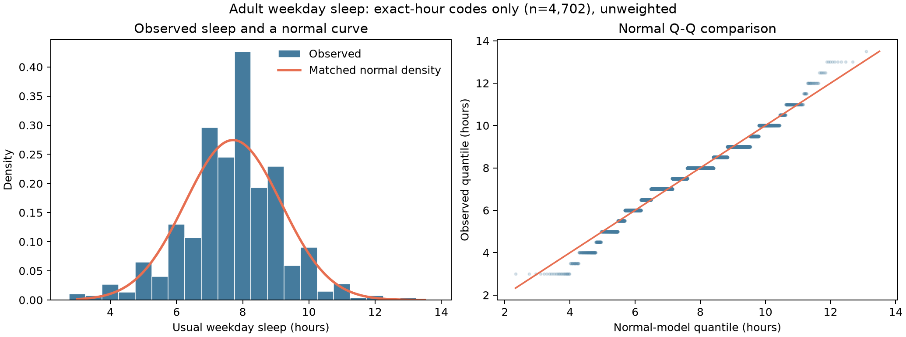

## 06_Quantitative Sleep Duration and the Normal Model

## Variable and analysis set

The underlying quantity is an adult's usual weekday/workday sleep duration in hours. NHANES derives `SLD012` from reported sleep and wake times and rounds it to the nearest half hour. The released variable is therefore **discretized**, even though duration is conceptually continuous. Code `2` means *less than 3 hours* and code `14` means *14 hours or more*; neither is an exact duration. For the numeric distribution and normal comparison, retain values from **3 through 13.5 hours**.

The [Phase 2 analysis set](01_Events_and_Random_Variable.md) contains 4,741 adults with valid supplement-use and weekday-sleep responses. Of these, **4,702** have exact-hour codes and **39** have one of the grouped endpoint codes. The histogram and normal Q-Q comparison below use the 4,702 exact-hour records, unweighted.

## Shape and normal approximation

The observed mean is **7.71 hours**, the median is **8.0 hours**, and the standard deviation is **1.45 hours**. The sample skewness is **-0.18**, indicating mild left skew by this measure. The histogram has a strong concentration at round and half-hour values, especially around 8 hours. The Q-Q plot shows steps caused by rounding and departures from the reference line in the tails. About **74.84%** of exact-hour values fall within one empirical standard deviation of the mean, compared with about **68.27%** for an exact normal distribution.

A fitted normal curve gives a rough description of the center but is **not a faithful model of the observed duration distribution**. It smooths over the half-hour heaping, does not reflect the grouped endpoint categories, and misses features of the tails. No normality test is used as a substitute for checking the plotted shape.

## Reproducibility and source

Run `python src/phase2_extended_analysis.py` from the project root. The script writes `data/processed/phase2/weekday_sleep_distribution_summary.csv` and the figure above. See the [NHANES sleep questionnaire documentation](https://wwwn.cdc.gov/Nchs/Data/Nhanes/Public/2021/DataFiles/SLQ_L.htm) for the derivation, rounding, and grouped endpoint codes.
