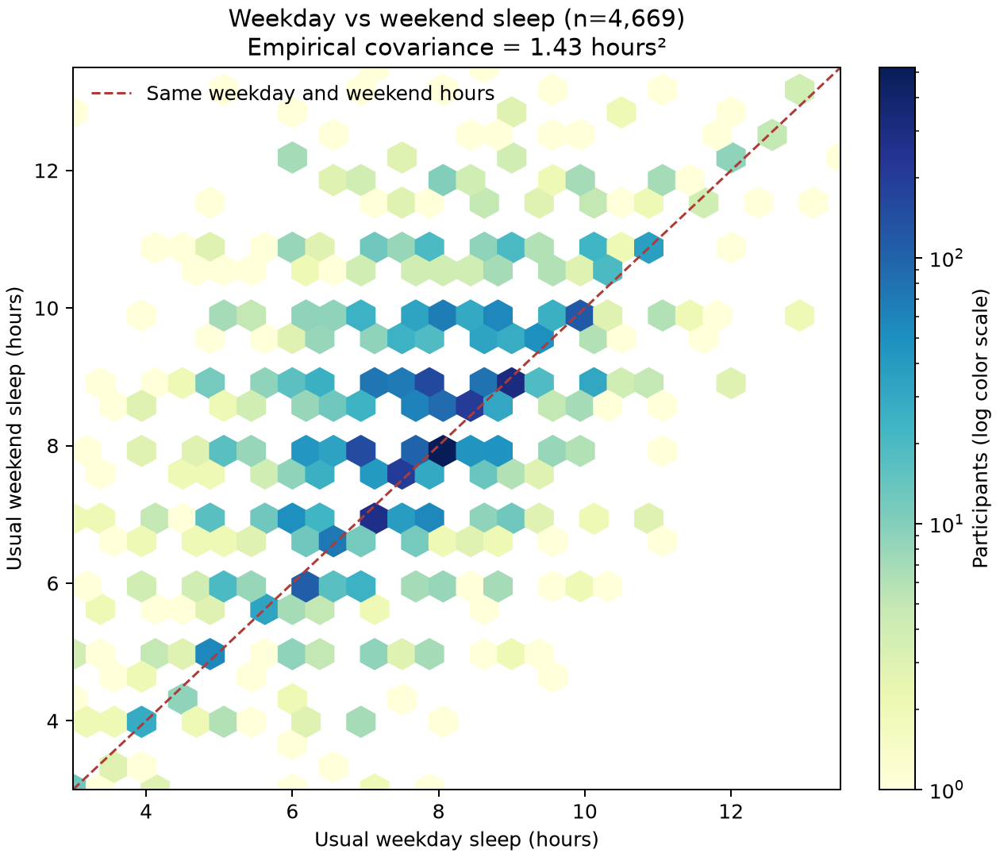

## 08_Two Sleep Variables and Covariance

## Paired variables

For the same adult, let X be usual weekday/workday sleep hours (`SLD012`) and Z be usual weekend/non-workday sleep hours (`SLD013`). Both measures must be exact-hour codes from **3 through 13.5 hours**. The paired analysis has **4,669 adults**, each contributing one pair. This is a separate complete-pair subset of the [Phase 2 analysis set](01_Events_and_Random_Variable.md), and all calculations are unweighted.

## Empirical covariance and interpretation

The paired-sample means are **7.7081 hours** on weekdays and **8.2269 hours** on weekends. Using the empirical-distribution denominator `n = 4,669`, the covariance is

`Cov(X, Z) = mean[(X - mean(X)) × (Z - mean(Z))] = +1.4279 hours²`.

The positive sign means that adults with above-average weekday sleep tend, in this sample, also to have above-average weekend sleep. The plot shows the upward association and the concentration at rounded half-hour values. Many observations lie above the equal-hours line, consistent with a higher average weekend duration in this paired subset. Covariance depends on the units and spread of both variables, so its numerical size is not a standardized strength measure. Formal correlation and population inference are reserved for a later phase.

The two durations are paired observations from the **same person**. Their covariance describes co-variation; it does not show that one duration causes the other or that supplement use explains the relationship.

## Reproducibility

Run `python src/phase2_extended_analysis.py` from the project root. The paired count, means, and covariance are written to `data/processed/phase2/weekday_weekend_covariance.csv`.
