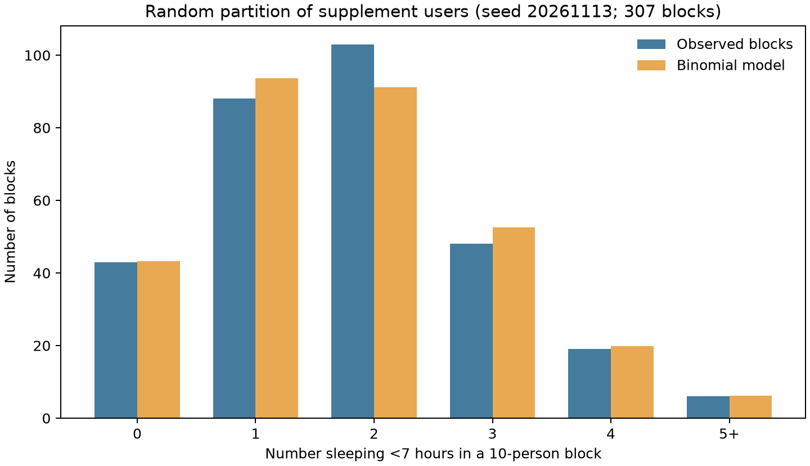

## A2_Binomial Counts in Equal-Size Subsamples

## Construction

Use the **3,070 supplement users** from the [Phase 2 analysis set](01_Events_and_Random_Variable.md). Of them, **546** report usual weekday sleep under 7 hours, so the empirical short-sleep fraction is `p = 546/3070 = 0.17785`. With a fixed random seed (`20261113`), randomly permute the 3,070 users and partition them into **307 non-overlapping groups of 10**. No user is left out. For each group, count the members with short weekday sleep. Compare the observed distribution of these 307 counts with a `Binomial(10, p)` model.

| Short sleepers in a group of 10 | Observed groups | Expected groups under `Binomial(10, 0.17785)` |
|---|---:|---:|
| 0 | 43 | 43.3 |
| 1 | 88 | 93.7 |
| 2 | 103 | 91.2 |
| 3 | 48 | 52.6 |
| 4 | 19 | 19.9 |
| 5 or more | 6 | 6.2 |
| **Total** | **307** | **307.0** |

The observed block-count variance is **1.430**, compared with the binomial value `10p(1-p) = 1.462`. The observed mean and binomial mean are both **1.779** because every supplement user appears exactly once and p was calculated from those same users; that equality is built into this construction, not independent evidence of model fit. The observed and model frequencies are fairly close in this one random partition, while individual bins still differ.

## Model limits

The groups were created **after data collection** by random partition; they are not NHANES sampling clusters. The counts in non-overlapping groups are constrained by the fixed total of 546 short sleepers, so the groups are not independent binomial samples. Within each group, selection is without replacement; [Task 2.5](05_Discrete_Count_and_Binomial_Model.md) shows why binomial probabilities are still numerically close for ten draws from 3,070 users. Another random seed would give a different observed table. This descriptive comparison does not validate the binomial assumptions for population inference, and no goodness-of-fit test is claimed.

## Reproducibility

Run `python src/phase2_extended_analysis.py` from the project root. The full observed and expected frequencies for counts 0 through 10 are saved to `data/processed/phase2/path_a2_equal_size_blocks.csv`.
