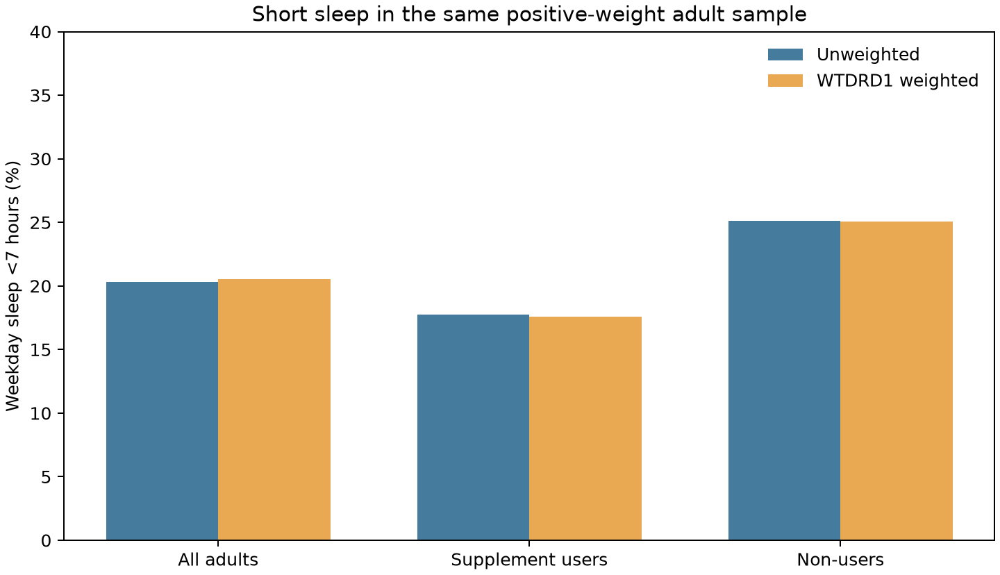

## A4_Raw and WTDRD1-Weighted Empirical Probability

## Weight and common comparison set

The main exposure, 30-day dietary supplement use (`DSD010`), comes from `DSQTOT_L`. Its [NHANES analytic notes](https://wwwn.cdc.gov/Nchs/Data/Nhanes/Public/2021/DataFiles/DSQTOT_L.htm) specify **`WTDRD1`**, the Day 1 dietary weight, for analysis involving the 30-day supplement data. This weight accounts for unequal selection probabilities and additional nonresponse and dietary-interview allocation. The linked demographics file also supplies the masked design variables `SDMVSTRA` and `SDMVPSU`.

For a fair raw-versus-weighted comparison, use the **same 4,737 adults** with valid supplement and weekday-sleep responses and a positive, finite `WTDRD1`. Four of the 4,741 adults in the earlier unweighted probability set are excluded here because their weight is not positive and finite. The outcome is `B`: usual weekday/workday sleep under 7 hours; endpoint code `2` (*less than 3 hours*) correctly counts as B.

| Group | Adults | Short-sleep adults | Unweighted P(B) | `WTDRD1`-weighted P(B) |
|---|---:|---:|---:|---:|
| All adults | 4,737 | 963 | 20.33% | 20.54% |
| Supplement users | 3,068 | 544 | 17.73% | 17.57% |
| Non-users | 1,669 | 419 | 25.10% | 25.04% |

For each row, the raw proportion is `number with B / number in group`. The weighted proportion is `sum(WTDRD1 × 1[B]) / sum(WTDRD1)` over the **same group**. For all adults, weighting changes the point estimate by **+0.21 percentage point** (using the displayed rounding). The within-group changes are also small in this particular complete-case sample; their size must be read from the data rather than assumed.

An unweighted sample frequency gives every retained respondent equal influence. NHANES participants represent different numbers of people after selection and response adjustments, so a weighted ratio has a different population-oriented interpretation. A weight-only point estimate does **not** supply a design-based standard error or confidence interval: those also require appropriate use of `SDMVSTRA` and `SDMVPSU`. Complete-case selection and self-reported sleep may still affect interpretation. No significance test is performed in Phase 2.

## Reproducibility

Run `python src/phase2_extended_analysis.py` from the project root. The shared-sample counts and both probability versions are saved to `data/processed/phase2/path_a4_weighted_probability.csv`. [Phase 1's weight documentation](../phase1/A2.Sampling_Weights_and_Design.md) records the rationale for choosing `WTDRD1`.
